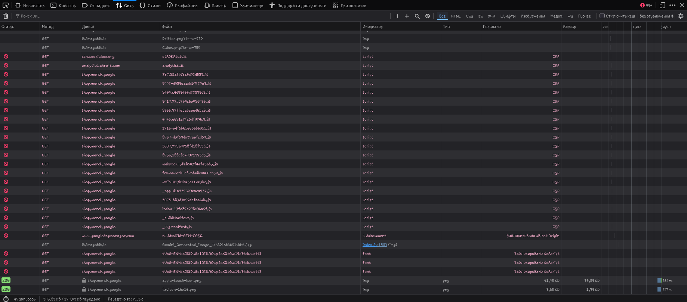
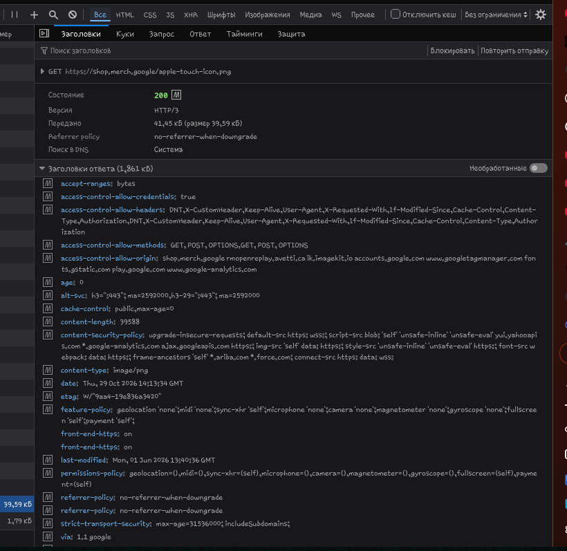

# Домашняя работа № 1 · Путь данных от ссылки до заявки

**Дисциплина:** ОП.03 «Информационные технологии»

| Поле | Значение |
|---|---|
| Фамилия, имя, отчество | Заруцкий Иван |
| Группа | РПО-1 |
| Номер работы | 1 |
| Тема работы | Цифровая воронка: путь данных от ссылки до заявки |
| Дата сдачи | 29.10.26 |

---

## 1. Какой сайт смотрел

| Поле | Значение |
|---|---|
| Название сайта | Google Merchandise Store |
| Адрес | https://shop.merch.google/ |
| Откуда сайт | Европапапапапаааа |

## 2. Три действия и что отправил счётчик

Панель Network, фильтр `collect`, галочка Preserve log. Название события лежит в параметре `en` на вкладке Payload.

| № | Что я сделал на сайте | Название события (`en`) | Что ещё было в Payload |
|---|---|---|---|
| 1 | обновил страницу | `page_view` | `dl` (адрес страницы), `dt` (заголовок), `cid` (идентификатор клиента), `sid` (идентификатор сессии)  |
| 2 | прокрутил до низа | `scroll` | `_p` (идентификатор загрузки страницы), `cid`, `sid`, `seg` (признак вовлечённости)  |
| 3 | нажал на товар | `view_item` | `ep.item_id`, `ep.item_name`, `ep.item_category`, `ep.currency`, `ep.value` — параметры просмотренного товара  |

Скриншоты:

## 3. Путь пользователя: 5 шагов

| № | Мой шаг | Пример |
|---|---|---|
| 1 | человек увидел ссылку на магазин в рекламном посте и нажал на неё | *человек увидел ссылку в сообществе и нажал на неё* |
| 2 | открылась главная страница Google Merchandise Store с каталогом товаров | *открылась главная страница сайта* |
| 3 | он прокрутил страницу и кликнул на понравившийся товар, чтобы посмотреть детали | *он прокрутил до формы записи* |
| 4 | на странице товара нажал «Add to cart», затем перешёл в корзину и заполнил данные для доставки | *начал заполнять: имя и телефон* |
| 5 | нажал кнопку оформления заказа — заявка (заказ) ушла в обработку | *нажал «Отправить», заявка ушла менеджеру* |

## 4. Где данные могут потеряться

| № | На каком шаге | Что может потеряться |
|---|---|---|
| 1 | шаг 1, переход по ссылке | в ссылке нет UTM-метки или она потерялась при редиректе — в отчётах не будет видно, из какого источника пришёл человек  |
| 2 | шаг 4–5, заполнение формы и оформление | блокировщик рекламы или запрет cookies в браузере пользователя может заблокировать отправку `collect`-запроса, и событие оформления не дойдёт до системы аналитики  |

## 5. Использование ИИ

| Вопрос | Ответ |
|---|---|
| Что сделал сам | Открыл сайт, включил панель разработчика, настроил фильтр `collect` и Preserve log, выполнил три действия, посмотрел параметр `en` на вкладке Payload, снял скриншоты |
| Что спросил у модели | Уточнил, какие параметры обычно передаются вместе с событиями `page_view`, `scroll` и `view_item` в GA4 |
| Что после этого изменил | Добавил в таблицу пункта 2 конкретные названия параметров (`dl`, `cid`, `ep.item_id` и т.д.), чтобы ответ был точнее, чем просто «адрес страницы» или «данные товара» |
